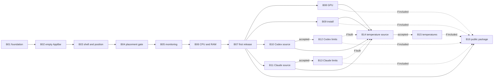

# Delivery roadmap

The roadmap translates the [product plan](../plan.md) into independently assignable bricks. A brick is a bounded unit of work with an observable result, explicit dependencies, acceptance criteria, and out-of-scope work.

The product plan, implementation plan, and accepted ADRs remain authoritative. If implementation reveals a design choice with meaningful alternatives, record it in a new ADR and update the affected brick; do not silently change the roadmap.

## How to pick up work

1. Choose a brick whose dependencies are complete.
2. Read the brick, every linked plan section, and every linked ADR.
3. Create the branch required by [`AGENTS.md`](../../AGENTS.md); brick IDs are roadmap identifiers, not branch names.
4. Satisfy every acceptance criterion. Automated tests do not replace the named Windows 11 desktop checks.
5. Put automated, Windows integration, and manual desktop evidence in separate dated reports under `docs/acceptance/`.

A brick can complete with a documented rejection only when its acceptance criteria define that outcome. It does not authorize a fallback or simulated data. A conditional implementation brick is `not applicable` when its qualification prerequisite is rejected.

## Stages

Every stage ends in an observable result. Stages 3–5 are independent tracks after the first personal release and may proceed in any order. Stage 6 starts only after B08 and B09 finish, both provider qualifications close, and each accepted provider's implementation finishes.

| Stage | Observable result |
|---|---|
| 0. Runnable foundation | The solution builds, the architecture boundary is enforced, and the test host is ready to host lifecycle components introduced by later bricks. |
| 1. Placement feasibility | An empty bar reliably reserves the primary monitor's edge, survives shell/display/fullscreen scenarios, and restores work area on exit. |
| 2. First personal release | A self-contained Windows 11 x64 folder shows trustworthy CPU load and RAM usage and passes every first-release gate. |
| 3. GPU track | The selected adapter's GPU load is shown only when adapter/counter correlation is proven. |
| 4. Installation track | Per-user install, optional autostart, upgrade, and uninstall work without elevating the bar. |
| 5. Subscription tracks | Each qualified Codex or Claude source independently shows remaining limits and reset times without reading credentials or consuming usage. |
| 6. Temperature track | A safe source is either accepted and exposed as temperature readings, or rejected with evidence; the bar remains unelevated. |
| 7. Public distribution | A clean-profile package passes the public-release checks and has authenticated payload provenance. |

B01–B07 produce the first personal release: roadmap stages 0–1 implement product-plan stage 1, and roadmap stage 2 implements product-plan stage 2. Failure of B04 blocks B05–B07 pending an explicit placement decision. B08–B15 never retroactively block an accepted B07 release.

## Brick table

| # | Brick | Area | Depends on |
|---|---|---|---|
| **Stage 0 — Runnable foundation** ||||
| B01 | [Solution and enforced Core boundary](B01-solution-boundary.md) | Core + Desktop | — |
| **Stage 1 — Placement feasibility** ||||
| B02 | [Empty AppBar lifecycle](B02-empty-appbar-lifecycle.md) | Desktop | B01 |
| B03 | [Tray, edge settings, and shell/display recovery](B03-shell-position-recovery.md) | Desktop | B02 |
| B04 | [Fullscreen reconciliation and placement gate](B04-placement-gate.md) | Desktop + acceptance | B03 |
| **Stage 2 — First personal release** ||||
| B05 | [Independent metric monitoring](B05-metric-monitoring.md) | Core | B04 |
| B06 | [CPU/RAM sources and bar presentation](B06-cpu-ram-presentation.md) | Core + Desktop | B05 |
| B07 | [First-release evidence and self-contained publication](B07-first-release.md) | Release | B06 |
| **Stage 3 — GPU track** ||||
| B08 | [GPU adapter selection, correlation, and display](B08-gpu.md) | Core + Desktop | B07 |
| **Stage 4 — Installation track** ||||
| B09 | [Per-user installation and autostart](B09-install-autostart.md) | Release | B07 |
| **Stage 5 — Subscription tracks** ||||
| B10 | [Qualify a Codex limit source](B10-codex-source.md) | Research | B07 |
| B11 | [Qualify a Claude limit source](B11-claude-source.md) | Research | B07 |
| B12 | [Codex remaining limits](B12-codex-limits.md) | Core + Desktop | B10 accepted |
| B13 | [Claude remaining limits](B13-claude-limits.md) | Core + Desktop | B11 accepted |
| **Stage 6 — Temperature track** ||||
| B14 | [Qualify temperature sources](B14-temperature-source.md) | Research | B08 done/rejected; B09 done; B10/B11 accepted/rejected; B12/B13 done/not applicable |
| B15 | [Temperature readings](B15-temperatures.md) | Core + Desktop | B14 accepted |
| **Stage 7 — Public distribution** ||||
| B16 | [Authenticated public package](B16-public-distribution.md) | Release | B07; every feature included in the package |

`Accepted` and `rejected` are explicit outcomes defined by a brick's acceptance criteria. A rejected B10, B11, or B14 closes that track; B12, B13, or B15 respectively becomes `not applicable`.

## Dependency graph



## Progress

Update this table when evidence changes a brick's state. Valid states are `planned`, `in progress`, `blocked`, `accepted`, `rejected`, `not applicable`, and `done`. `Rejected` requires an explicit rejection path in the brick; `not applicable` requires rejection of that brick's qualification prerequisite.

| Brick | Status |
|---|---|
| B01–B16 | planned |

## Brick template

```markdown
# BNN — Title

| | |
|---|---|
| **Area** | Core / Desktop / Release / Research |
| **Depends on** | BNN — or “—” |
| **Unblocks** | BNN — or “—” |
| **Sources** | links to exact plan sections and ADRs |

## Why

The problem this brick closes and why it is separate.

## What done looks like

An observable result rather than an implementation layer.

## Context

Required behavior, invariants, evidence, and named outputs not already owned by a linked source.

## Acceptance criteria

- [ ] Checkable outcomes, each proven by a command, automated check, or named manual scenario

## Out of scope

Explicit neighbouring work, with its owning brick where applicable.
```
