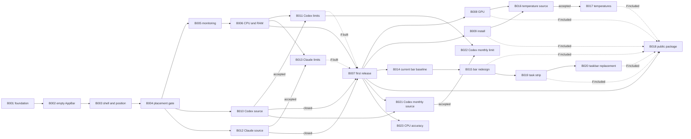

# Delivery roadmap

The roadmap translates the [product plan](../plan.md) into independently assignable bricks. A brick is a bounded unit of work with an observable result, explicit dependencies, acceptance criteria, and out-of-scope work.

The product plan, implementation plan, and accepted ADRs remain authoritative. If implementation reveals a design choice with meaningful alternatives, record it in a new ADR and update the affected brick; do not silently change the roadmap.

## How to pick up work

1. Choose a brick whose dependencies are complete.
2. Open the brick's package. Read its brief, every linked plan section, every linked ADR, and its package plan when present.
3. Create the branch required by [`AGENTS.md`](../../AGENTS.md); brick IDs are roadmap identifiers, not branch names.
4. Satisfy every acceptance criterion. Automated tests do not replace the named Windows 11 desktop checks.
5. Put automated, Windows integration, and manual desktop evidence in separate dated reports under `docs/acceptance/`.

A brick can complete with a documented rejection only when its acceptance criteria define that outcome. It does not authorize a fallback or simulated data. A conditional implementation brick is `not applicable` when its qualification prerequisite is rejected.

## Stages

Every stage ends in an observable result. Stages 3–5, 10, and 11 are independent tracks after the first personal release and may proceed in any order. Stage 6 starts only after B008 and B009 finish. Stage 8 starts after B015; stage 9 starts only after B019 finishes. Stage 10 preserves the accepted 5-hour and weekly Codex contract.

| Stage | Observable result |
|---|---|
| 0. Runnable foundation | The solution builds, the architecture boundary is enforced, and the test host is ready to host lifecycle components introduced by later bricks. |
| 1. Placement feasibility | An empty bar reliably reserves the primary monitor's edge, survives shell/display/fullscreen scenarios, and restores work area on exit. |
| 2. First personal release (v1) | A self-contained Windows 11 x64 folder shows trustworthy CPU load, RAM usage, and used limits and reset times for each qualified Codex or Claude source, and passes every first-release gate. |
| 3. GPU track | The selected adapter's GPU load is shown only when adapter/counter correlation is proven. |
| 4. Installation track | Per-user install, optional autostart, upgrade, and uninstall work without elevating the bar. |
| 5. Current bar baseline and shared redesign | The current WPF bar is measured on Windows 11, then receives the approved shared layout and passes its desktop and resource gates. |
| 6. Temperature track | A safe source is either accepted and exposed as temperature readings, or rejected with evidence; the bar remains unelevated. |
| 7. Public distribution | A clean-profile package passes the public-release checks and has authenticated payload provenance. |
| 8. Task strip | The bar shows an icon-only task button for each task on every monitor and a clock, while the Windows taskbar stays reachable. |
| 9. Taskbar replacement | The bar shows every tray icon and its own volume, network, and battery indicators; the Windows taskbar is hidden while the replacement works, or the feasibility gate rejects the phase. |
| 10. Codex monthly track | An allowed source is accepted or rejected with evidence; when accepted, the bar adds the qualified monthly used limit and reset information. |
| 11. CPU accuracy track | The bar's CPU reading is compared with Task Manager on the target PC, and the CPU accuracy gate passes or records its failure with evidence. |

B001–B007 and B010–B013 produce the first personal release ([ADR 0004](../adr/0004-subscription-limits-in-first-release.md)): roadmap stages 0–1 implement product-plan stage 1; roadmap stage 2 implements product-plan stages 2 and 3. Provider qualification (B010, B012) starts after B004 and runs in parallel with B005–B006. B007 waits until both qualifications close and every accepted provider's implementation is done; a rejected provider closes its track without blocking B007. Failure of B004 blocks B005–B007 and B010–B013 pending an explicit placement decision. B008, B009, and B014–B023 never retroactively block an accepted B007 release.

Bundling an official Codex client is an [unscheduled post-release candidate](../plan.md#bundled-codex-candidate), not a first-release brick. Create a bounded brick only after the feasibility work and ADR establish its scope and acceptance gates.

On 2026-10-20, B011 and B012 exchanged assignments: B011 now owns Codex display and B012 qualifies Claude. [DOC-020's dated Codex report](../research/providers/codex-2026-10-19.md) and earlier acceptance reports retain their original brick numbers as historical evidence; use this roadmap for current dependencies.

The post-release IDs changed twice. [PR #54](https://github.com/maxViolet/System-Resource-Monitor/pull/54) moved the then-B014 temperature-source brick to B015 and added the shared redesign as B014. On 2026-11-11, [ADR 0026](../adr/0026-post-release-brick-renumbering.md) reserved B014 for the current-bar baseline and moved the then-current B014–B021 assignments to B015–B022. Historical PR titles, reports, and accepted ADRs retain their original IDs; use ADR 0026's two dated mappings to find the live brick.

B021/B022 are the post-release [Codex monthly track](../plan.md#codex-monthly-limit). B021 qualifies or rejects an allowed source without changing production code. Only acceptance unblocks B022; rejection leaves B011 without a monthly field.

## Brick table

| # | Brick | Area | Depends on |
|---|---|---|---|
| **Stage 0 — Runnable foundation** ||||
| B001 | [Solution and enforced Core boundary](B01-solution-boundary/README.md) | Core + Desktop | — |
| **Stage 1 — Placement feasibility** ||||
| B002 | [Empty AppBar lifecycle](B02-empty-appbar-lifecycle/README.md) | Desktop | B001 |
| B003 | [Tray, edge settings, and shell/display recovery](B03-shell-position-recovery/README.md) | Desktop | B002 |
| B004 | [Fullscreen reconciliation and placement gate](B04-placement-gate/README.md) | Desktop + acceptance | B003 |
| **Stage 2 — First personal release (v1)** ||||
| B005 | [Independent metric monitoring](B05-metric-monitoring/README.md) | Core | B004 |
| B006 | [CPU/RAM sources and bar presentation](B06-cpu-ram-presentation/README.md) | Core + Desktop | B005 |
| B010 | [Qualify a Codex limit source](B10-codex-source/README.md) | Research | B004 |
| B011 | [Codex limits](B11-codex-limits/README.md) | Core + Desktop | B006; B010 accepted |
| B012 | [Qualify a Claude limit source](B12-claude-source/README.md) | Research | B004 |
| B013 | [Claude limits](B13-claude-limits/README.md) | Core + Desktop | B006; B012 accepted |
| B007 | [First-release evidence and self-contained publication](B07-first-release/README.md) | Release | B006; B010/B012 accepted/rejected; B011/B013 done/not applicable |
| **Stage 3 — GPU track** ||||
| B008 | [GPU adapter selection, correlation, and display](B08-gpu/README.md) | Core + Desktop | B007 |
| **Stage 4 — Installation track** ||||
| B009 | [Per-user installation and autostart](B09-install-autostart/README.md) | Release | B007 |
| **Stage 5 — Current bar baseline and shared redesign** ||||
| B014 | [Record the current bar baseline](B14-current-bar-baseline/README.md) | Desktop + acceptance evidence | B007 |
| B015 | [Implement the shared bar redesign](B15-bar-redesign/README.md) | Desktop + acceptance | B014 done |
| **Stage 6 — Temperature track** ||||
| B016 | [Qualify temperature sources](B16-temperature-source/README.md) | Research | B008 done/rejected; B009 done |
| B017 | [Temperature readings](B17-temperatures/README.md) | Core + Desktop | B016 accepted |
| **Stage 7 — Public distribution** ||||
| B018 | [Authenticated public package](B18-public-distribution/README.md) | Release | B007; every feature included in the package |
| **Stage 8 — Task strip** ||||
| B019 | [Task strip and clock](B19-task-strip/README.md) | Desktop | B015 |
| **Stage 9 — Taskbar replacement** ||||
| B020 | [Own tray, shell indicators, and hidden Windows taskbar](B20-taskbar-replacement/README.md) | Desktop + acceptance | B019 |
| **Stage 10 — Codex monthly track** ||||
| B021 | [Qualify a Codex monthly limit source](B21-codex-monthly-source/README.md) | Research | B007 done; B010 accepted |
| B022 | [Codex monthly limit](B22-codex-monthly-limit/README.md) | Core + Desktop | B011 done; B021 accepted |
| **Stage 11 — CPU accuracy track** ||||
| B023 | [Measure and improve CPU accuracy against Task Manager](B23-cpu-accuracy/README.md) | Desktop + Core + acceptance | B007 |

`Accepted` and `rejected` are explicit outcomes defined by a brick's acceptance criteria. Rejected B010, B012, B016, or B021 makes B011, B013, B017, or B022 respectively `not applicable`; rejected B020 closes the taskbar-replacement track.

## Side tasks

| Owner | Task | Status |
|---|---|---|
| B013 | [B013.1 - Accept Claude 2.1.319 context advice](B13-claude-limits/B13.1-claude-2.1.319-context-advice.md) | planned |

## Dependency graph



## Progress

Update this table when evidence changes a brick's state. Valid states are `planned`, `in progress`, `blocked`, `accepted`, `rejected`, `not applicable`, and `done`. `Rejected` requires an explicit rejection path in the brick; `not applicable` requires rejection of that brick's qualification prerequisite.

| Brick | Status |
|---|---|
| B001 | in progress |
| B002–B003 | planned |
| B004 | done |
| B005 | planned |
| B006 | done |
| B007 | done |
| B008–B009 | planned |
| B010 | accepted |
| B011 | in progress |
| B012 | accepted |
| B013 | in progress |
| B014 | in progress |
| B015–B023 | planned |

B007 is `done` by user decision on 2026-10-16 after [PR #25](https://github.com/maxViolet/System-Resource-Monitor/pull/25) merged. Its separate acceptance reports are not present in `docs/acceptance/`; the [B008 automated report](../acceptance/2026-10-16-B08-automated.md) records this handoff limitation and the affected gate reruns. B008 remains `planned` until its applicable acceptance criteria have evidence.

B014 records a new measured baseline without reclassifying B007's historical status. Before B014 is marked `done`, each failed or unverified first-release gate must have a named open brick or follow-up owner. B011 remains the owner of the known Codex combined-memory failure. B015 still requires its affected rendering, desktop, CPU, and memory gates to pass; baseline completion does not waive them.

## Brick template

```markdown
# BNN — Title

| | |
|---|---|
| **Area** | Core / Desktop / Release / Research |
| **Depends on** | BNN — or “—” |
| **Unblocks** | BNN — or “—” |
| **Sources** | links to exact plan sections and ADRs |

## Why

The problem this brick closes and why it is separate.

## What done looks like

An observable result rather than an implementation layer.

## Context

Required behavior, invariants, evidence, and named outputs not already owned by a linked source.

## Acceptance criteria

- [ ] Checkable outcomes, each proven by a command, automated check, or named manual scenario

## Out of scope

Explicit neighbouring work, with its owning brick where applicable.
```
