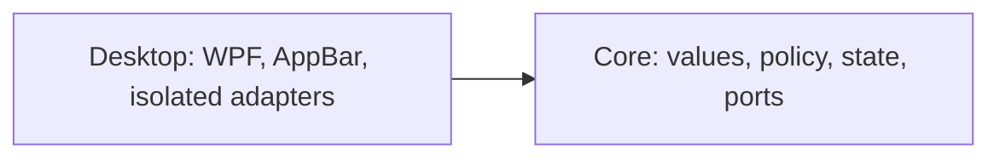

# MVP implementation plan

The [product plan](plan.md) defines scope and release order. [ADR 0002](adr/0002-appbar-first-cpu-ram-release.md) records the two-project architecture.

## Technology and layout

Use C# on .NET 10: Core targets plain `net10.0`; Desktop targets `net10.0-windows` and publishes for x64. Use WPF, System.Text.Json, and direct Win32 interop in Desktop. Pin the SDK in global.json, enable nullable and warnings as errors, and commit package lock files. Generic Host may coordinate lifecycle. Blocking or potentially slow metric-source, file, and process operations run off the UI thread. HWND/AppBar operations, SetWindowPos, HwndSource message handling, tray icon actions, and monitor/DPI work tied to the window run on its owning WPF thread. Keep those handlers short; marshal collector results to the WPF dispatcher before updating UI-bound state.

```text
SystemResourceMonitor.slnx
src/
  SystemResourceMonitor.Core/
    Metrics/
    Monitoring/
    Settings/
  SystemResourceMonitor.Desktop/
    AppBar/
    Adapters/Windows/
    Adapters/Settings/
    ViewModels/
    Views/
    Tray/
    App.xaml.cs
tests/
  SystemResourceMonitor.Core.Tests/
  SystemResourceMonitor.Desktop.Tests/
  SystemResourceMonitor.Desktop.TestHost/
```



Core has no Desktop dependency. Desktop adapters implement Core ports; view models do not reference concrete adapters. Wire implementations in App.xaml.cs. Do not introduce speculative repositories, mediators, generic result wrappers, or provider/thermal interfaces before their feature is accepted.

Enforce the Core boundary at build time. Add `Microsoft.CodeAnalysis.BannedApiAnalyzers` to Core only, include a Core `BannedSymbols.txt` as an `AdditionalFiles` item, and treat `RS0030` as an error. Ban `System.IO.File`, `System.IO.Directory`, `System.Diagnostics.Process`, `Microsoft.Win32.Registry`, `DllImportAttribute`, and `LibraryImportAttribute` by documentation-comment symbol IDs. Keep the project-reference rule as well. At slice 0, verify the check with temporary negative probes for each banned family: each must fail Core compilation with `RS0030`; remove the probes before committing. Review new I/O or interop entry points when dependencies change, since the list is a boundary check rather than a proof against every platform API.

## Initial model and workflows

- MetricReading contains kind, finite percentage in 0..100, UTC MeasuredAt, and availability. RAM also carries physical used/total bytes for the GiB tooltip.
- DashboardState is immutable CPU/RAM state with one change notification. Marshal notifications once at the Desktop boundary.
- Source ports read CPU and RAM independently. One failure or blocked source must not stop the other source's acquisition or expiry.
- Inject TimeProvider; use UTC for measurement records and elapsed-time scheduling for deadlines. Do not wrap it in IClock.
- Each collector polls every 2 seconds without overlapping its own reads. CPU uses GetSystemTimes deltas; the first sample is unavailable. Counter reset/invalid delta discards the baseline. RAM uses GlobalMemoryStatusEx: (total - available) / total. These two synchronous native calls are accepted as short, in-process first-release reads, not as cancellable calls; run them on background thread-pool workers and measure their duration on the target PC. Neither reader owns a long-lived native handle.
- A separate expiry mechanism marks each reading unavailable at age >=6 seconds, even while its collector is blocked. Failed reads do not renew MeasuredAt. Tooltip explains missing updates; known-invalid readings become unavailable immediately.
- Cancellation stops scheduling new polls and prevents late results from publishing; it does not interrupt an in-flight GetSystemTimes or GlobalMemoryStatusEx call. Never start a second read for that source while one is pending. If an accepted first-release native call exceeds the 2-second poll interval, record the overrun and retain the no-overlap and 6-second freshness rules. Two consecutive overruns from either reader fail the first-release responsiveness gate. `Task.Run` keeps these short reads off the UI thread but does not make them cancellable.
- A future provider or thermal source that can genuinely block must run in a separate child process with a request timeout. On timeout or shutdown, terminate the child process tree, wait for exit within the remaining shutdown deadline, and release its owned resources only after exit. If termination cannot be confirmed, fail that source's acceptance and do not enable it. Do not run potentially blocking, non-terminable adapters in-process.
- Startup loads settings, establishes the single-instance guard, shows/registers the bar, and starts collectors. A second process never registers another AppBar.

## Settings and lifecycle

First-release settings contain only Top/Bottom edge, default Top. Store at %LocalAppData%\SystemResourceMonitor\settings.json. Write a temporary file in the same directory and replace atomically. Missing settings use defaults. Preserve malformed settings as settings.invalid-<timestamp>.json when possible; inability to read, back up, or write settings does not prevent monitoring. On persistence failure, report that the current position applies only until restart.

Create one borderless, non-activating primary-monitor window. On its owning WPF thread, register ABM_NEW, negotiate ABM_QUERYPOS, then ABM_SETPOS. Handle position notifications, WM_DISPLAYCHANGE, WM_DPICHANGED, TaskbarCreated, and primary-monitor changes. Fullscreen follows [ADR 0003](adr/0003-keep-appbar-registered-during-fullscreen.md): keep AppBar registration and its reserved strip throughout fullscreen; lower the window to the bottom of the z-order, then restore its normal z-order without activation when fullscreen is no longer active on the primary monitor. Never use ABM_REMOVE for a fullscreen transition. Never steal focus.

Treat ABN_FULLSCREENAPP as a trigger to reconcile current foreground-window bounds and monitor, not as an authoritative global fullscreen flag. Reconcile additionally every 500 ms so Alt+Tab restoration does not depend on game termination or another shell notification. Compare the foreground top-level window against the full primary-monitor bounds in consistent physical-pixel coordinates, not the reduced work area; exclude the bar and shell desktop windows. Coalesce checks and change z-order only when state changes. This reconciliation remains active while the bar is lowered and is included in the resource-budget measurements. Test maximized ordinary windows as a negative case.

On `TaskbarCreated`, restore both shell integrations on the owning WPF thread: call `ABM_NEW`, then `ABM_QUERYPOS` and `ABM_SETPOS` to reserve the strip; call `Shell_NotifyIcon(NIM_ADD)` to recreate the tray icon, followed by `Shell_NotifyIcon(NIM_SETVERSION)` for its callback behavior. Check the native return values and report a failed recovery rather than assuming either resource exists. Reconcile fullscreen state before restoring z-order. This recovery is separate from fullscreen transitions: the latter never unregister the AppBar. On monitor/DPI/primary-monitor changes, renegotiate and reconcile against current monitor geometry.

On exit or handled fatal startup failure, stop publishing state, cancel collectors, and remove AppBar immediately in an idempotent finally path, before awaiting collectors. Wait at most 2 seconds total. If the deadline expires, record which operation remains pending, reject any late result, do not dispose resources still in use, and finish process exit without awaiting that operation again. Observe completion/fault of any pending managed task while the process remains alive; process termination ends its background workers. The first-release CPU/RAM readers own no long-lived native handles, so an in-flight read cannot race their disposal. Future child-process adapters must be terminated and their exit confirmed inside the deadline; a failure to do so fails feature acceptance. Demonstrate the deadline path with a never-completing, handle-free fake source in the separate test host described below. Abrupt OS/process termination is distinct from handled cancellation and must not be claimed as covered by finally.

Native wrappers check return codes, structure sizes, pointer widths, and handle ownership; use SafeHandle where appropriate. Tray provides position and exit only in the first release.

## Delivery slices

### Slice 0: runnable skeleton and empty AppBar

Create `SystemResourceMonitor.slnx` at the repo root and add Core, Desktop, both test projects, and the dedicated Windows test-host project. Create Core/Desktop, tests, the Core banned-API check, single-instance guard, blank AppBar, tray, edge persistence, and shutdown. Do not gate this work on provider or temperature research.

Pass build/tests and verify second launch leaves one process/window and exit leaves no background process. Use the separate test host to inject a handled startup failure and verify work-area restoration. Run every placement scenario in product-plan stage 1 on the published app. After an Explorer restart, verify the tray icon is present and its position and Exit actions still work. Perform ten top/bottom switches and verify no stale reservations. Record focus behaviour and work area before/during/after each scenario.

Time-box placement investigation to two working days. Remaining blocking failures stop dependent work pending an explicit placement/suspension decision and, if needed, ADR 0001 revision.

### Slice 1: first personal CPU/RAM release

Implement independent collectors and expiry, fixed-width CPU/RAM text, RAM GiB tooltip, and unavailable tooltip. A slow collector never overlaps itself or blocks the other collector. Measure native-read duration in the test host on the target PC for 30 minutes of normal polling; two consecutive GetSystemTimes or GlobalMemoryStatusEx calls longer than the 2-second poll interval fail the responsiveness gate. No empty placeholders for deferred features are required.

Publish a self-contained folder; document extraction, launch, position, exit, settings errors, and unavailable readings. No install scripts or autostart yet. Run each gate below against its named artifact; fault-injection gates use a separate test host built from the same commit.

### Later slices

1. GPU: implement adapter selection/correlation and reused PDH queries only now; use product-plan stage 3 acceptance, with unavailable rather than guessed correlation.
2. Installation/autostart: per-user Run entry and scripts, without elevation; verify product-plan stage 4. Preserve settings during upgrade and make uninstall's settings-retention choice explicit.
3. Providers: independently researched, conditionally implemented after their spike passes. Keep parsing separate from process execution, use sanitized fixtures, absolute executable paths, redirected streams, timeout and process-tree termination. Never log raw account output or secrets. Implement independent provider polls and independent three-minute expiry; unknown format/version is unavailable. Local non-credential file sources remain allowed by the product plan. Accept each built adapter only after the manual official-client comparison and access-loss checks in the product plan; parser fixture tests do not substitute for those checks.
4. Temperatures: last, after source/license/driver/Defender checks; no elevation of the bar. No acceptable source means no temperatures.

Later feature acceptance reruns affected first-release gates, including resource budgets with the enabled feature configuration. These slices do not retroactively block the CPU/RAM release.

## First-release acceptance gates

All thresholds below are release-blocking, not record-only. They are agreed initial budgets for the target PC, not measured results. Use two artifacts from one commit: the clean, self-contained published app for normal operation, accuracy, resource, and desktop gates; a separate Release executable from `SystemResourceMonitor.Desktop.TestHost` for injected blocked-source and startup-failure gates. The test host instantiates the same production lifecycle components with fake sources at their composition seam; its injection code and fixtures live only in the test-host project and are excluded from the published folder. It must exercise a real HWND/AppBar on Windows 11 for work-area assertions. Record the commit and SHA-256 of both executable artifacts and their loaded production assemblies, plus PC/CPU, Windows build, logical processor count, display/DPI/taskbar configuration, instrumentation, timestamps, raw observations, and pass/fail. Evidence from one artifact does not establish behavior of the other. Untested scenarios remain open.

| Gate | Artifact | Method and pass condition |
|---|---|---|
| CPU accuracy | Published app | Idle and sustained CPU load separately: 30 paired observations at 2-second intervals, compared with Task Manager using the same 60-second observation window. Difference between window means <=5 percentage points in each regime. Record transition spikes separately. |
| RAM accuracy | Published app | Idle and sustained load separately: 30 paired observations per regime against Task Manager physical memory usage. Absolute difference <=2 percentage points in at least 29/30 observations in each regime. Record used/total values and timestamps. |
| App CPU cost | Published app | Release build, 30 minutes at idle; process CPU time delta / elapsed wall time / logical processor count *100 <=0.5%. Report this whole-machine-normalized definition explicitly. |
| App memory ceiling | Published app | Sample process private bytes every 2 seconds during the 30-minute idle run and eight-hour run; every sample <=150 MiB. |
| Memory growth | Published app | Warm up 30 minutes, then observe for 8 hours with 2-second private-byte samples. Last 30-minute mean minus first 30-minute mean <=10 MiB. This gate does not prove absence of all leaks. |
| Native-read responsiveness | Test host | Use the production CPU/RAM wrappers for 30 minutes on the target PC; timestamp every call. Neither reader has two consecutive calls longer than 2 seconds. The published app also remains responsive throughout its desktop and resource runs. |
| Freshness and independence | Test host | Block one collector; its reading expires at 6 seconds while the other keeps updating. Test exact boundary with fake time; observe actual UI transition within 0.5 seconds of deadline under the desktop smoke. |
| Normal shutdown | Published app | Normal exit restores prior work area before collector wait; process exits without leftovers. |
| Fault shutdown | Test host | Inject a handled startup failure and a never-completing, handle-free source. Both restore prior work area before collector wait. At the 2-second total deadline, pending work is recorded, late results cannot publish, no in-use resource is disposed, and the process exits without leftovers. |
| Desktop behaviour | Published app | All product-plan stage 1 scenarios pass on actual Windows 11. Ten enter/leave cycles each for video, exclusive fullscreen, and borderless fullscreen, including Alt+Tab to a normal window and back: lower only for active fullscreen on the primary monitor; restore within 1 second after departure, without focus stealing. Keep registration and reservation unchanged through transitions. Separately verify Explorer restart during fullscreen, fullscreen on a second monitor, and ordinary maximized windows. After Explorer recovery the strip is reserved, correct z-order returns, and the restored tray icon's position and Exit actions work. |
| Artifact hygiene | Published app | Folder runs without separately installed .NET, no elevation, no provider authorization, and no test host, fixtures, secrets, development configuration, or production diagnostic hook. |

For the eight-hour run keep normal monitoring active; record workload changes and interruptions. Missing samples or interrupted runs cannot be counted as a passing complete run. Keep automated, Windows integration, and manual desktop evidence separate under docs/acceptance/ in dated reports.

## Automated verification and handoff

Permanent tests cover percentage/RAM invariants, CPU delta arithmetic and reset, independent failures, no overlap, six-second expiry during a blocked read, exact deadline, bounded shutdown, and settings recovery/write failure. Desktop lifecycle tests cover registered-to-lowered-to-restored transitions without ABM_REMOVE, Alt+Tab while the game stays running, other-monitor fullscreen, repeated notifications, maximized-window exclusion, and Explorer recovery that recreates both AppBar and tray icon before reconciliation. The Core `net10.0` target, project-reference rule, and `RS0030` banned-API build check enforce its boundary; slice-0 negative probes verify the check itself. Test actual settings files with temporary directories; avoid mock echoes, DI registration tests, and XAML/property-forwarding tests.

Windows integration exercises native wrappers, mutex and AppBar where practical. Actual published-app checks remain mandatory; CI success alone cannot close desktop or resource gates.

Once application projects exist, run on Windows 11:

```powershell
dotnet restore SystemResourceMonitor.slnx -r win-x64 --locked-mode
dotnet build SystemResourceMonitor.slnx -c Release -r win-x64 --no-restore
dotnet test SystemResourceMonitor.slnx -c Release -r win-x64 --no-build --no-restore
dotnet publish src/SystemResourceMonitor.Desktop/SystemResourceMonitor.Desktop.csproj -c Release -r win-x64 --self-contained true -p:RestoreLockedMode=true
git diff --check
```

Copy the published folder to the target PC for its named gates. Run injected-fault gates with the separate test host on the same target PC; record both artifact hashes and the common commit. Build/test/publish commands are future implementation checks; this documentation change does not establish that any have passed.

## Public distribution gate

The first personal release may remain unsigned. Do not distribute a build publicly until the public-release checks in the product plan pass and a signed provenance manifest authenticates the exact payload files being distributed. Generate the manifest after final packaging; include source commit and SHA-256 for every payload file, including executables, DLLs, and scripts. Sign it with a release key whose verification key or fingerprint users obtain from an independently authenticated channel, separate from the artifact download. On the final distribution package, verify the manifest signature against that trusted key and recompute every listed hash; reject missing, extra, or mismatched payload files. Record the trusted-key identity, signature-verification result, package/manifest hashes, and release commit. A plain SHA-256 file beside the download is only an integrity check and cannot close this gate.

## Out of scope

Multiple bars/non-primary placement, graphs/history/alerts, customizable refresh/fonts/size, browser automation/cookies, undocumented provider endpoints, credential storage, billing balances, interactive sign-in, automatic updates, MSIX/MSI, Authenticode signing for the personal release, localization, telemetry, privileged helpers, and platforms other than Windows 11 x64. Authenticated provenance is required before public distribution as specified above.
