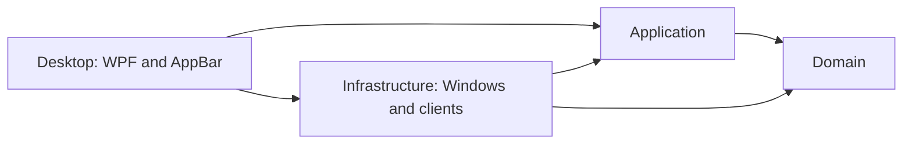

# MVP implementation plan

This document turns the product stages in [the product plan](plan.md) into buildable vertical slices. Architecture and stack choices are recorded in [ADR 0002](adr/0002-dotnet-wpf-clean-architecture.md).

## MVP outcome

The MVP is a single-user Windows 11 desktop application that:

- runs once per user session and owns one bar on the primary monitor;
- reserves work area through the AppBar API at the top or above the Windows taskbar;
- shows CPU load, RAM usage, GPU load, and every temperature supported by an accepted source;
- refreshes system metrics every 2 seconds without blocking the UI thread;
- can start at Windows sign-in and can be exited from a tray menu;
- releases reserved work area on normal exit and after handled startup failures;
- shows Codex or Claude limits only for providers that pass the product plan's source spike.

A provider that fails its spike is not simulated and does not delay the system-metrics MVP. CPU temperature is unavailable when no source passes its driver, privilege, license, and antivirus checks.

## Technology baseline

- C# on .NET 10, `net10.0-windows`, x64.
- WPF for the window, bindings, tray integration, and Win32 interop host.
- `Microsoft.Extensions.Hosting` for dependency injection and coordinated start/stop.
- `System.Text.Json` for local settings and provider payloads when JSON is available.
- P/Invoke for AppBar, monitor, CPU, memory, and PDH GPU APIs. Keep native handles behind `SafeHandle` where ownership applies.
- Self-contained folder publication for `win-x64`; no single-file bundling in the MVP.
- No database, network service, browser automation, telemetry, or credential store.

Pin the .NET SDK in `global.json`, enable nullable reference types and warnings as errors, and commit the generated `packages.lock.json` files.

## Solution layout

```text
SystemResourceMonitor.sln
src/
  SystemResourceMonitor.Domain/
    Metrics/
    Limits/
  SystemResourceMonitor.Application/
    Abstractions/
    Monitoring/
    Settings/
  SystemResourceMonitor.Infrastructure/
    Metrics/Windows/
    Limits/Codex/
    Limits/Claude/
    Settings/
    Startup/
  SystemResourceMonitor.Desktop/
    AppBar/
    ViewModels/
    Views/
    Tray/
    App.xaml
    App.xaml.cs
tests/
  SystemResourceMonitor.Domain.Tests/
  SystemResourceMonitor.Application.Tests/
  SystemResourceMonitor.Infrastructure.Tests/
scripts/
  install.ps1
  uninstall.ps1
```



`Desktop` references `Infrastructure` only in `App.xaml.cs`, the composition root. Views and view models use Application and Domain contracts, never concrete infrastructure types.

## Layer responsibilities

| Layer | Owns | Must not own |
|---|---|---|
| Domain | Metric values, limit windows and snapshots, availability and failure categories, value invariants | WPF types, timers, files, processes, registry, P/Invoke |
| Application | Polling workflows, freshness rules, provider selection, current dashboard state, settings use cases | Windows handles, XAML, JSON layout, CLI parsing |
| Infrastructure | Windows metric readers, provider adapters, JSON settings store, autostart implementation | Presentation state, business freshness decisions |
| Desktop | AppBar lifecycle, WPF bindings, tray commands, tooltip rendering, composition root | Metric collection, client parsing, persistence rules |

Rules:

- Dependencies point inward; Domain references no other project.
- One interface exists only when an outer-layer implementation crosses an architectural boundary. Do not add repositories, commands, mediators, mapping layers, or generic result wrappers speculatively.
- Domain and Application use `DateTimeOffset` in UTC. Inject .NET `TimeProvider`; do not create an `IClock` wrapper.
- Cancellation is mandatory for polling, child processes, and shutdown. No fire-and-forget tasks.
- UI-bound state changes are marshalled once at the Desktop boundary; collectors never use the WPF dispatcher.

## Core model and contracts

### Domain values

- `MetricReading`: metric kind, numeric value, unit, `MeasuredAt`, and availability. Enforce percentages in `0..100`; temperature remains a finite Celsius value.
- `SystemMetricsSnapshot`: CPU load, CPU temperature, RAM usage, GPU load, GPU temperature, and `CapturedAt`. Each reading can be unavailable independently.
- `LimitWindow`: provider label, window label, remaining whole percent, reset time, and window kind (`Short` or `Weekly`). Enforce percentages in `0..100`.
- `LimitSnapshot`: provider, non-empty windows ordered as supplied by the provider, and `CapturedAt`. It derives the short value and the binding weekly value; it does not assume exactly two windows.
- `SourceFailure`: one of `SignedOut`, `Network`, `Unsupported`, `MalformedResponse`, or `Unexpected`, plus a safe user-facing message. Never carry credentials or raw provider output.
- `SourceState<T>`: `Available`, `Stale`, or `Unavailable`, with the latest value only where policy permits it.

### Application ports

- `ISystemMetricsSource.ReadAsync(CancellationToken)` returns a full `SystemMetricsSnapshot`; one unavailable sensor does not fail the whole snapshot.
- `ILimitSource.Provider` and `ReadAsync(CancellationToken)` return either a `LimitSnapshot` or a categorized `SourceFailure`.
- `ISettingsStore.LoadAsync` and `SaveAsync` persist `AppSettings`.
- `IAutostartManager.GetAsync`, `EnableAsync`, and `DisableAsync` manage sign-in startup.
- `IDashboardState` exposes the current immutable state and one change notification for Desktop.

### Application workflows

- `SystemMetricsMonitor` owns one `PeriodicTimer` at 2 seconds. It prevents overlapping reads, publishes one snapshot per completed poll, converts unexpected source exceptions into unavailable readings, and continues unless cancellation was requested.
- `SubscriptionLimitsMonitor` owns one 1-minute timer and polls enabled providers independently. A sign-in error becomes unavailable immediately. A network error retains the last success as stale only until `CapturedAt + 3 minutes`; all other failures become unavailable immediately.
- `DashboardState` performs atomic snapshot replacement. The WPF view model reads one coherent state per notification instead of subscribing to individual collectors.
- Startup loads settings, starts the two monitors, then shows the bar. Shutdown cancels monitors, waits for them, removes the AppBar, disposes native resources, and stops the host.

## Infrastructure design

### Windows system metrics

- CPU load: sample `GetSystemTimes`; retain the previous idle/kernel/user counters and calculate utilization from deltas. The first sample is unavailable because no delta exists.
- RAM usage: call `GlobalMemoryStatusEx` and calculate `(total - available) / total × 100`.
- GPU load: enumerate adapters through DXGI, select the hardware adapter with the greatest dedicated video memory, then read PDH `GPU Engine` utilization and take the maximum among 3D, Compute, Copy, and Video engines for that adapter. If adapter-to-counter correlation cannot be made reliably, report GPU load unavailable rather than combining adapters.
- Temperatures: implement `IHardwareTemperatureSource` only after the stage 3 spike selects a source. The adapter maps package CPU and selected-GPU sensors to the domain snapshot. Keep a no-temperature implementation so the rest of the MVP is buildable.
- Native queries execute off the UI thread. Reuse PDH queries and counter buffers between polls; do not recreate them every 2 seconds.

Every native wrapper checks return codes, uses explicit structure sizes and architecture-safe pointer types, and has an integration smoke on Windows 11. Native handles have deterministic disposal.

### Subscription limits

Each provider adapter is independent and is included only after its stage 1 spike passes.

- Execute the official client directly, never through `cmd.exe` or PowerShell.
- Use an absolute executable path resolved at startup, redirected standard streams, no shell window, a bounded timeout, and process-tree termination on timeout or shutdown.
- Parse a documented machine-readable format when available. Keep parsing separate from process execution and cover it with sanitized fixtures.
- Convert used percentages to remaining percentages using the provider's verified rounding rule.
- Never read tokens, browser cookies, or credential files; never log raw output that may contain account data.
- A provider version or shape that is not recognized returns `Unsupported` or `MalformedResponse`, not guessed data.

### Settings and startup

`AppSettings` contains only:

- bar edge (`Top` or `Bottom`);
- enabled limit providers;
- start-at-sign-in preference.

Store it at `%LocalAppData%\SystemResourceMonitor\settings.json`. Write a temporary file in the same directory and atomically replace the previous file. Missing settings use defaults; malformed settings are preserved as `settings.invalid-<timestamp>.json` and replaced with defaults.

Use `HKCU\Software\Microsoft\Windows\CurrentVersion\Run` for autostart when the selected temperature source does not require elevation. If an accepted source requires elevation, use a per-user Task Scheduler task with highest privileges as required by the product plan. Do not implement both paths before the temperature-source decision.

### Installation

Publish with:

```powershell
dotnet publish src/SystemResourceMonitor.Desktop/SystemResourceMonitor.Desktop.csproj -c Release -r win-x64 --self-contained true
```

`install.ps1` copies the published folder to `%LocalAppData%\Programs\SystemResourceMonitor`, preserves settings, and optionally enables autostart. `uninstall.ps1` disables autostart before deleting binaries and leaves settings only when explicitly requested. Public signing and installer packaging are post-MVP.

## Desktop and AppBar lifecycle

- Enforce one process per user with a named mutex. A second process exits with a clear message and never registers another AppBar.
- Create one borderless, non-activating WPF window on the primary monitor. It is topmost only as required by AppBar behaviour and must not steal focus.
- On source initialization, register with `ABM_NEW`, negotiate the rectangle through `ABM_QUERYPOS`, then apply it with `ABM_SETPOS`.
- Handle AppBar position notifications, `WM_DISPLAYCHANGE`, `WM_DPICHANGED`, Explorer's `TaskbarCreated` message, and a primary-monitor change by renegotiating the rectangle.
- On fullscreen entry on the primary monitor, remove the AppBar reservation and hide the window. Re-register and show it on exit. A shell notification is a trigger; verify the foreground window's monitor and bounds before changing state so fullscreen on another monitor does not hide the bar.
- On shutdown and handled fatal startup errors, call `ABM_REMOVE` in a `finally` path. Removal is idempotent.
- The tray menu contains position, start-at-sign-in, and exit actions. Position and autostart changes apply immediately and persist only after the operation succeeds.
- The bar presents `—` for an unavailable system reading and `--/--` for unavailable limits. Tooltips show all provider windows and reset times, or the safe failure message.

## Delivery slices

Each slice leaves the application runnable. Do not begin a conditional slice until its spike passes.

### Slice 0 — technical spikes and solution skeleton

1. Run the Codex and Claude limit-source spikes from product-plan stage 1; record each result in a dated document under `docs/spikes/`.
2. Run the temperature-source spike from product-plan stage 3; record source, license, driver, privilege, and Defender results in `docs/spikes/` and capture a resulting ADR if a library or driver is selected.
3. Create the solution and four production projects with dependency checks.
4. Add the Generic Host, single-instance guard, blank bar window, and graceful cancellation.

Acceptance:

- `dotnet build` and `dotnet test` pass on Windows 11.
- A dependency test rejects Domain or Application references to Desktop or Infrastructure.
- Starting a second process leaves one process and one window.
- Closing the blank app exits without a background process.

### Slice 1 — AppBar shell

1. Add the native AppBar wrapper and lifecycle controller.
2. Add top/bottom settings and tray exit.
3. Handle Explorer restart, display/DPI changes, primary-monitor change, taskbar auto-hide, and fullscreen transitions.
4. Add settings persistence for the edge.

Acceptance:

- The real Windows 11 checks in product-plan stage 2 pass.
- The work area is smaller while the bar is active and restored after exit, startup failure, and forced cancellation handled by the application.
- Repeated top/bottom changes do not leave stale reservations.

### Slice 2 — system metrics

1. Implement CPU and RAM readers and the 2-second monitor.
2. Implement adapter selection and GPU load.
3. Add the accepted temperature source, or the no-temperature implementation if the spike failed.
4. Bind snapshots to fixed-width bar sections without layout movement when values change.

Acceptance:

- The bar stays responsive while collecting for 30 minutes.
- CPU, RAM, and GPU follow the independent tools and tolerances recorded by product-plan stage 3 at idle and under load.
- Disconnecting or disabling one supported sensor makes only that reading unavailable.
- Poll work does not overlap when a read exceeds 2 seconds.

### Slice 3 — subscription limits, per passing provider

For each provider independently:

1. Add direct process execution, parser fixtures, version detection, and failure categorization.
2. Add the 1-minute monitor and 3-minute network staleness policy.
3. Add compact `short%/weekly%` text and the all-windows tooltip.
4. Repeat the non-consuming poll check with the built adapter.

Acceptance:

- The real account checks in product-plan stages 1 and 4 pass.
- Sign-out becomes unavailable on the first failed poll.
- A simulated network failure shows stale data only through the 3-minute boundary, then `--/--`.
- One provider's timeout does not delay system metrics or the other provider.

### Slice 4 — startup, install, and release candidate

1. Implement the autostart path chosen after the temperature spike.
2. Add install/uninstall scripts and self-contained publication.
3. Add user documentation for installation, position, autostart, exit, unavailable sensors, and unavailable providers.
4. Run the clean-profile check from product-plan stage 5.

Acceptance:

- Install, sign out/in, disable autostart, exit, and uninstall all leave the expected process, registry/task, files, and work area state.
- The app starts without Codex or Claude authorization; metrics remain usable and provider sections are unavailable.
- Defender reports no warning for the published folder.
- The release artifact contains no test fixtures, credentials, raw provider output, or development-only configuration.

## Verification strategy

Permanent tests cover behaviour and boundaries:

- Domain: percentage and finite-value invariants; binding weekly-window selection; no-weekly-window behaviour.
- Application: initial state; successful replacement; immediate sign-in failure; network stale-to-unavailable transition at exactly 3 minutes; independent providers; cancellation while polling; no overlapping reads.
- Infrastructure: CPU delta arithmetic including counter wrap/restart; RAM arithmetic; sanitized provider response fixtures; unknown versions and malformed values; atomic settings recovery.
- Desktop/Windows integration: AppBar register, renegotiate, remove, Explorer restart recovery, and mutex behaviour on a Windows 11 runner where practical.

Do not unit-test XAML bindings, DI registrations, property forwarding, or mock echoes. Prove UI and Win32 behaviour by launching the actual application on Windows 11 and observing the bar, work area, tray, tooltips, fullscreen transitions, and cleanup.

Before an MVP handoff, run:

```powershell
dotnet restore -r win-x64 --locked-mode
dotnet build -c Release --no-restore
dotnet test -c Release --no-build
dotnet publish src/SystemResourceMonitor.Desktop/SystemResourceMonitor.Desktop.csproj -c Release -r win-x64 --self-contained true --no-restore
git diff --check
```

Then install the published output on the target Windows 11 PC and run every real-machine acceptance check named in the delivery slices.

## Explicitly out of scope

- Multiple bars or choosing a non-primary monitor.
- Historical graphs, persistence of metric history, alerts, or remote monitoring.
- Editing refresh intervals, colours, fonts, or bar size.
- API billing balances, browser-cookie access, direct calls to undocumented provider endpoints, or interactive provider sign-in.
- Automatic updates, MSIX/MSI packaging, code signing, localization, or public telemetry.
- Supporting x86, ARM64, Windows 10, Linux, or macOS.
