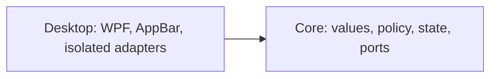

# MVP implementation plan

The [product plan](plan.md) defines scope and release order. [ADR 0002](adr/0002-appbar-first-cpu-ram-release.md) records the two-project architecture and AppBar feasibility gate.

## Technology and layout

Use C# and .NET 10. `Core` targets plain `net10.0`; `Desktop` targets `net10.0-windows` x64 and uses WPF, System.Text.Json, and direct Win32 interop. Pin the SDK in `global.json`, enable nullable and warnings as errors, and commit package lock files generated for `win-x64`.

```text
SystemResourceMonitor.slnx
src/
  SystemResourceMonitor.Core/
    Metrics/
    Monitoring/
    Settings/
  SystemResourceMonitor.Desktop/
    AppBar/
    Adapters/Windows/
    Adapters/Settings/
    ViewModels/
    Views/
    Tray/
    app.manifest
    App.xaml.cs
tests/
  SystemResourceMonitor.Core.Tests/
  SystemResourceMonitor.Desktop.Tests/
```



Core has no Desktop dependency. Desktop adapters implement Core ports; view models do not reference concrete adapters. Wire implementations in `App.xaml.cs`. Do not introduce speculative repositories, mediators, generic result wrappers, or provider/thermal interfaces before their feature is accepted.

Enforce the boundary rather than relying only on review:

- Core targets `net10.0`, does not set `UseWPF` or `UseWindowsForms`, and cannot reference Desktop.
- BannedApiAnalyzers in Core rejects direct file, directory, process, registry, `DllImport`, and `LibraryImport` use.
- An architecture test checks project references and the banned-symbol configuration.

`App.xaml.cs` owns the process-lifetime cancellation source, collector tasks, and deterministic shutdown sequence. Do not add Generic Host to the first release; reconsider it only when a concrete hosted-service requirement appears.

## Initial model and workflows

- `MetricReading` is an explicit union:
  - `AvailableMetric` contains kind, finite percentage in `0..100`, UTC `MeasuredAt`, a monotonic timestamp from `TimeProvider.GetTimestamp()`, and optional RAM used/total bytes;
  - `UnavailableMetric` contains kind and one reason: `NotYetSampled`, `Expired`, `Invalid`, or `ReadFailed`.
- `DashboardState` is immutable CPU/RAM state with one change notification. Marshal notifications once at the Desktop boundary.
- Source ports read CPU and RAM independently. One failure cannot stop the other source's acquisition or expiry.
- Inject `TimeProvider`; use UTC only for display and evidence, and monotonic timestamps for age and deadlines. Do not wrap it in `IClock`.
- Each collector polls every 2 seconds without overlapping its own reads. CPU uses `GetSystemTimes` deltas; the first sample is `NotYetSampled`. Counter reset or an invalid delta discards the baseline and produces `Invalid`. RAM uses `GlobalMemoryStatusEx`: `(total - available) / total`.
- A separate timer marks each reading `Expired` at age `>= 6 seconds`, even while its collector is running. Failed reads do not renew either timestamp. Tooltips map the unavailability reason to a safe explanation.
- `GetSystemTimes` and `GlobalMemoryStatusEx` are accepted as short synchronous OS calls. Execute them on collector worker tasks so they do not block the WPF dispatcher; cancellation stops future polls but cannot interrupt a call already inside Windows.
- A future source that can wait indefinitely is excluded from the process until it has a bounded API or is isolated in a child process that can be terminated. `Task.Run` alone is not isolation.
- Startup acquires the single-instance guard first. A second process exits before reading or writing settings. The owner then loads settings, creates and registers the bar, and starts collectors.

## Settings and lifecycle

First-release settings contain only Top/Bottom edge, default Top. Store them at `%LocalAppData%\SystemResourceMonitor\settings.json`. Write a temporary file in the same directory and replace atomically. Missing settings use defaults. Preserve malformed settings as `settings.invalid-<timestamp>.json` when possible; inability to read, back up, or write settings does not prevent monitoring. On persistence failure, report that the current position applies only until restart.

Potentially blocking metric, file, and process operations never run on the UI thread. HWND, AppBar, tray, monitor, and DPI operations run on the WPF thread that owns the window.

On exit or handled fatal startup failure:

1. stop publishing state and cancel future polls;
2. remove the AppBar immediately in an idempotent `finally` path on the window thread;
3. wait at most 2 seconds total for collector tasks;
4. observe every completed task and dispose only resources no longer in use;
5. exit the process.

Production CPU/RAM sources are not expected to outlive that deadline. The blocked-source shutdown case uses a fault-injecting test adapter in a separate test-host build; production must not contain an in-process source that can remain blocked. Abrupt OS/process termination is distinct from handled cancellation and is not claimed as covered by `finally`.

## AppBar and shell behaviour

- Declare `PerMonitorV2` DPI awareness in `app.manifest`.
- Create one borderless, non-activating window on the primary monitor. Never steal focus.
- Register `ABM_NEW` with a `RegisterWindowMessage` callback, negotiate with `ABM_QUERYPOS`, and commit with `ABM_SETPOS`.
- Treat AppBar rectangles as physical pixels. Derive thickness from the current monitor DPI and apply the negotiated rectangle with `SetWindowPos(..., SWP_NOACTIVATE)`, not WPF DIP position properties.
- Handle `ABN_POSCHANGED`, `ABN_STATECHANGE`, `ABN_FULLSCREENAPP`, `WM_DISPLAYCHANGE`, and `WM_DPICHANGED` on the window thread. On a DPI change, renegotiate AppBar placement rather than accepting a stale WPF rectangle.
- On primary-monitor change, remove the old registration, move to the new primary monitor, register there, and verify that the previous work area is restored.
- Determine fullscreen state by checking the foreground window's bounds and monitor; ignore this app, shell windows, and fullscreen windows on another monitor.
- Fullscreen on the primary monitor releases the reservation with `ABM_REMOVE` and hides the bar. Because removal stops AppBar notifications, install out-of-context `SetWinEventHook` hooks for `EVENT_SYSTEM_FOREGROUND` and `EVENT_OBJECT_LOCATIONCHANGE` before removal. While hidden, a 1-second fallback timer also reevaluates fullscreen state. When fullscreen ends, remove the fallback timer, call `ABM_NEW`/`ABM_QUERYPOS`/`ABM_SETPOS`, and show the bar. Both hook and timer callbacks marshal to the window thread.
- On `TaskbarCreated`, re-add the tray icon with `NIM_ADD` and `NIM_SETVERSION`. If the bar is visible, also register it again and renegotiate placement; if currently hidden for fullscreen, keep it unregistered until fullscreen exit.
- Native wrappers check return codes, structure sizes, pointer widths, callback lifetimes, and handle ownership; use `SafeHandle` where ownership applies.
- The first-release tray contains position and exit actions only.

## Delivery slices

### Slice 0: runnable skeleton and empty AppBar

Create the solution, Core/Desktop projects, tests, boundary enforcement, single-instance guard, blank AppBar, tray, edge persistence, and shutdown. Do not gate this work on provider or temperature research.

Pass build/tests and verify second launch leaves one process/window, exit leaves no background process, and handled startup failure restores work area. Run every placement scenario in product-plan stage 1. Perform ten top/bottom switches and verify no stale reservations. Record focus behaviour and work area before/during/after each scenario.

Time-box placement investigation to two working days. Remaining blocking failures stop dependent work pending an explicit placement/suspension decision and, if needed, ADR 0001 revision.

### Slice 1: first personal CPU/RAM release

Implement independent collectors and expiry, fixed-width CPU/RAM text, RAM GiB tooltip, and unavailable tooltips. A slow collector never overlaps itself, blocks the other collector, or delays UI exit. No empty placeholders for deferred features are required.

Publish a self-contained folder; document extraction, launch, position, exit, settings errors, and unavailable readings. No install scripts or autostart yet.

Run accuracy, resource, artifact, and real-desktop gates on the exact published production artifact. Run blocked-collector, exact-expiry, and handled-startup-failure gates on a separate test-host build from the same commit with fault-injecting adapters. Record both artifact SHA-256 values and never distribute the test host.

### Independent later slices

These slices may proceed in any order after the first release and do not retroactively block it.

- **GPU:** implement adapter selection/correlation and reused PDH queries; use product-plan stage 3 acceptance, with unavailable rather than guessed correlation.
- **Installation/autostart:** implement the product-plan stage 4 controls independently of GPU. Preserve settings during upgrade and make uninstall's settings-retention choice explicit.
- **Providers:** research and implement each provider independently after its spike passes. Apply all provider execution and acceptance requirements below.
- **Temperatures:** research source/license/driver/Defender behaviour last; never elevate the bar. No acceptable source means no temperatures.

Later feature acceptance reruns affected first-release gates, including resource budgets with the enabled feature configuration.

## Deferred-feature requirements

### Provider adapters

- Resolve an official client from authoritative installation metadata or explicit user selection, never the current directory or the first untrusted `PATH` hit.
- Canonicalize the final executable path, reject reparse redirection and locations writable by other principals, and verify its publisher signature where the official client supplies one. An unverifiable user-installed script client requires explicit user consent.
- Start the verified executable directly with `UseShellExecute=false`, fixed argument tokens, a neutral working directory, no shell window, and a bounded timeout.
- Drain stdout and stderr concurrently with independent byte limits. Bound parser depth and record/token counts; on any limit, timeout, or cancellation, terminate the process tree and mark the provider unavailable.
- Keep parsing separate from process execution and use sanitized fixtures. Never retain or log raw account output, credentials, tokens, cookies, or browser data.
- Poll providers independently. Sign-out becomes unavailable on the first failed poll. A network failure retains explicitly stale data only until three minutes from the last success; expiry uses its own timer and does not wait for another poll.
- Reject unknown formats and versions. Convert used to remaining percentage with the official client's verified rounding and select the binding weekly window by the glossary rule.
- Acceptance compares every displayed remaining value and reset time with the official client in the same verification window, confirms the failure explanation in the tooltip after access loss, and repeats the ten-poll non-consumption check. Manual account comparison is separate from parser tests.

### Installation and autostart

- Install under a fixed canonical per-user directory with ACLs that do not grant write access to other principals. Recheck ACLs and reject reparse points during install, upgrade, registration, and uninstall.
- Write one owned `HKCU\Software\Microsoft\Windows\CurrentVersion\Run` `REG_SZ` value containing a correctly quoted absolute executable path, no shell interpolation, and no user-controlled arguments.
- Uninstall removes only that exact Run value and manifest-listed application files. Cover paths with spaces, planted prefix executables, changed ACLs, and junction/symlink replacement.

## First-release acceptance gates

All thresholds below are release-blocking, not record-only. They are agreed initial budgets for the target PC, not measured results. Untested scenarios remain open; tests and screenshots from another build do not close them.

| Gate | Artifact | Method and pass condition |
|---|---|---|
| CPU accuracy | Production | Idle and sustained CPU load separately: 30 paired observations at 2-second intervals, compared with Task Manager using the same 60-second observation window. Difference between window means `<= 5` percentage points in each regime. Record transition spikes separately. |
| RAM accuracy | Production | Idle and sustained load separately: 30 paired observations per regime against Task Manager physical memory usage. Absolute difference `<= 2` percentage points in at least 29/30 observations in each regime. Record used/total values and timestamps. |
| App CPU cost | Production | Published Release build, 30 minutes at idle; process CPU time delta / elapsed wall time / logical processor count × 100 `<= 0.5%`. Report this whole-machine-normalized definition explicitly. |
| App memory ceiling | Production | Sample process private bytes every 2 seconds during the 30-minute idle run and eight-hour run; every sample `<= 150 MiB`. |
| Memory growth | Production | Warm up 30 minutes, then observe for 8 hours with 2-second private-byte samples. Last 30-minute mean minus first 30-minute mean `<= 10 MiB`. This does not prove absence of all leaks. |
| Freshness and independence | Test host | Block one collector; its reading expires at 6 seconds while the other keeps updating. Test the exact boundary with fake time; observe actual UI transition within 0.5 seconds of the deadline. |
| Shutdown | Both | Production normal exit restores prior work area before waiting. Test-host handled startup failure and blocked-source cancellation do the same; total collector wait is `<= 2 seconds` and each process exits without leftovers. |
| Desktop behaviour | Production | All product-plan stage 1 scenarios pass on Windows 11: no focus stealing or stale reservations; primary-monitor changes move and reserve on the new primary while restoring the old work area; fullscreen exit restores the bar and reservation; Explorer restart restores AppBar and working tray actions. |
| DPI and rendering | Production | At 100%, 150%, and 200% scaling, the reserved strip matches the rendered bar; CPU/RAM sections remain fixed, unclipped, and stable for 0%, 100%, and unavailable; the RAM tooltip shows used/total GiB. |
| Artifact | Production | Folder runs without separately installed .NET, elevation, provider authorization, fixtures, secrets, or development configuration. |

For the eight-hour run, keep normal monitoring active and record workload changes and interruptions. Missing samples or interrupted runs cannot count as a passing complete run.

Commit only a sanitized acceptance report under `docs/acceptance/`: target hardware category, Windows build, logical processor count, display/DPI/taskbar configuration, commit, artifact hashes, instrumentation, aggregate observations, and pass/fail. Keep raw traces privately only as long as needed to diagnose the run. Never commit usernames, absolute user paths, account/provider output, process or window titles, environment dumps, precise activity timelines, or unredacted screenshots.

## Automated verification and handoff

Permanent tests cover metric invariants and unavailable reasons, CPU delta arithmetic and reset, independent failures, no overlap, monotonic six-second expiry during a blocked read, exact deadline, bounded shutdown, settings recovery/write failure, and Core dependency rules. Test actual settings files with temporary directories; avoid mock echoes, DI registration tests, and XAML/property-forwarding tests.

Windows integration exercises native wrappers, mutex, AppBar, DPI conversion, fullscreen recovery, and Explorer restart where practical. Actual published-app checks remain mandatory; CI success alone cannot close desktop or resource gates.

Once application projects exist, run on Windows 11:

```powershell
dotnet restore SystemResourceMonitor.slnx --locked-mode
dotnet build SystemResourceMonitor.slnx -c Release --no-restore
dotnet test SystemResourceMonitor.slnx -c Release --no-build --no-restore
dotnet publish src/SystemResourceMonitor.Desktop/SystemResourceMonitor.Desktop.csproj -c Release -r win-x64 --self-contained true -p:RestoreLockedMode=true
git diff --check
```

Copy the published production folder to the target PC and execute its assigned first-release gates. Build/test/publish commands are future implementation checks; this documentation change does not establish that any have passed.

## Public distribution gate

The personal release may remain unsigned. Public distribution is prohibited until release provenance is authenticated. Before public distribution, Authenticode-sign the executable and install/uninstall scripts and verify those signatures, or publish a signed checksum/provenance manifest through an independently authenticated channel. A digest stored beside the artifact is not sufficient.

## Out of scope

Multiple bars/non-primary placement, graphs/history/alerts, customizable refresh/fonts/size, browser automation/cookies, undocumented provider endpoints, credential storage, billing balances, interactive sign-in, automatic updates, MSIX/MSI, localization, telemetry, privileged helpers, and platforms other than Windows 11 x64. Code signing is outside the personal MVP but required by the public distribution gate.
