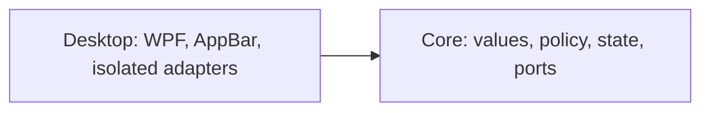

# MVP implementation plan

The [product plan](plan.md) defines scope and release order. [ADR 0003](adr/0003-appbar-first-cpu-ram-release.md) records the two-project architecture. This revision replaces PR #3's all-metrics MVP and mandatory source spikes with an AppBar-first CPU/RAM release.

## Technology and layout

Use C#, .NET 10, `net10.0-windows`, x64, WPF, System.Text.Json, and direct Win32 interop. Pin the SDK in global.json, enable nullable and warnings as errors, and commit package lock files. Generic Host may coordinate lifecycle; native calls must never run on the UI thread.

```text
src/
  SystemResourceMonitor.Core/
    Metrics/
    Monitoring/
    Settings/
  SystemResourceMonitor.Desktop/
    AppBar/
    Adapters/Windows/
    Adapters/Settings/
    ViewModels/
    Views/
    Tray/
    App.xaml.cs
tests/
  SystemResourceMonitor.Core.Tests/
  SystemResourceMonitor.Desktop.Tests/
```



Core has no Desktop dependency. Desktop adapters implement Core ports; view models do not reference concrete adapters. Wire implementations in App.xaml.cs. Do not introduce speculative repositories, mediators, generic result wrappers, or provider/thermal interfaces before their feature is accepted.

## Initial model and workflows

- MetricReading contains kind, finite percentage in 0..100, UTC MeasuredAt, and availability. RAM also carries physical used/total bytes for the GiB tooltip.
- DashboardState is immutable CPU/RAM state with one change notification. Marshal notifications once at the Desktop boundary.
- Source ports read CPU and RAM independently. One failure or blocked source must not stop the other source's acquisition or expiry.
- Inject TimeProvider; use UTC for measurement records and elapsed-time scheduling for deadlines. Do not wrap it in IClock.
- Each collector polls every 2 seconds without overlapping its own reads. CPU uses GetSystemTimes deltas; the first sample is unavailable. Counter reset/invalid delta discards the baseline. RAM uses GlobalMemoryStatusEx: (total - available) / total.
- A separate expiry mechanism marks each reading unavailable at age >=6 seconds, even while its collector is blocked. Failed reads do not renew MeasuredAt. Tooltip explains missing updates; known-invalid readings become unavailable immediately.
- Bound source execution and honor cancellation. A source that cannot support bounded termination is excluded until isolated appropriately; Task.Run alone does not make a native call cancellable.
- Startup loads settings, establishes the single-instance guard, shows/registers the bar, and starts collectors. A second process never registers another AppBar.

## Settings and lifecycle

First-release settings contain only Top/Bottom edge, default Top. Store at %LocalAppData%\SystemResourceMonitor\settings.json. Write a temporary file in the same directory and replace atomically. Missing settings use defaults. Preserve malformed settings as settings.invalid-<timestamp>.json when possible; inability to read, back up, or write settings does not prevent monitoring. On persistence failure, report that the current position applies only until restart.

Create one borderless, non-activating primary-monitor window. Register ABM_NEW, negotiate ABM_QUERYPOS, then ABM_SETPOS. Handle position notifications, WM_DISPLAYCHANGE, WM_DPICHANGED, TaskbarCreated, and primary-monitor changes. Verify fullscreen foreground bounds and monitor before releasing the reservation and hiding; re-register on exit from fullscreen. Never steal focus.

On exit or handled fatal startup failure, stop publishing state, cancel collectors, and remove AppBar immediately in an idempotent finally path, before awaiting collectors. Wait at most 2 seconds total for collectors; safely dispose completed operations and stop the host. Do not dispose handles still in use or leave an unobserved background operation as the termination strategy. Demonstrate process exit with a blocked test source. Abrupt OS/process termination is distinct from handled cancellation and must not be claimed as covered by finally.

Native wrappers check return codes, structure sizes, pointer widths, and handle ownership; use SafeHandle where appropriate. Tray provides position and exit only in the first release.

## Delivery slices

### Slice 0: runnable skeleton and empty AppBar

Create Core/Desktop, tests, single-instance guard, blank AppBar, tray, edge persistence, and shutdown. Do not gate this work on provider or temperature research.

Pass build/tests and verify second launch leaves one process/window, exit leaves no background process, and handled startup failure restores work area. Run every placement scenario in product-plan stage 1. Perform ten top/bottom switches and verify no stale reservations. Record focus behaviour and work area before/during/after each scenario.

Time-box placement investigation to two working days. Remaining blocking failures stop dependent work pending an explicit placement/suspension decision and, if needed, ADR 0001 revision.

### Slice 1: first personal CPU/RAM release

Implement independent collectors and expiry, fixed-width CPU/RAM text, RAM GiB tooltip, and unavailable tooltip. A slow collector never overlaps itself, blocks the other collector, or delays UI exit. No empty placeholders for deferred features are required.

Publish a self-contained folder; document extraction, launch, position, exit, settings errors, and unavailable readings. No install scripts or autostart yet. Every gate below must pass on the exact published artifact.

### Later slices

1. GPU: implement adapter selection/correlation and reused PDH queries only now; use product-plan stage 3 acceptance, with unavailable rather than guessed correlation.
2. Installation/autostart: per-user Run entry and scripts, without elevation; verify product-plan stage 4. Preserve settings during upgrade and make uninstall's settings-retention choice explicit.
3. Providers: independently researched, conditionally implemented after their spike passes. Keep parsing separate from process execution, use sanitized fixtures, absolute executable paths, redirected streams, timeout and process-tree termination. Never log raw account output or secrets. Implement independent provider polls and independent three-minute expiry; unknown format/version is unavailable. Local non-credential file sources remain allowed by the product plan.
4. Temperatures: last, after source/license/driver/Defender checks; no elevation of the bar. No acceptable source means no temperatures.

Later feature acceptance reruns affected first-release gates, including resource budgets with the enabled feature configuration. These slices do not retroactively block the CPU/RAM release.

## First-release acceptance gates

All thresholds below are release-blocking, not record-only. They are agreed initial budgets for the target PC, not measured results. Record PC/CPU, Windows build, logical processor count, display/DPI/taskbar configuration, artifact commit and SHA-256, instrumentation, timestamps, raw observations, and pass/fail. Untested scenarios remain open; tests and screenshots from another build do not close them.

| Gate | Method and pass condition |
|---|---|
| CPU accuracy | Idle and sustained CPU load separately: 30 paired observations at 2-second intervals, compared with Task Manager using the same 60-second observation window. Difference between window means <=5 percentage points in each regime. Record transition spikes separately. |
| RAM accuracy | Idle and sustained load separately: 30 paired observations per regime against Task Manager physical memory usage. Absolute difference <=2 percentage points in at least 29/30 observations in each regime. Record used/total values and timestamps. |
| App CPU cost | Published Release build, 30 minutes at idle; process CPU time delta / elapsed wall time / logical processor count *100 <=0.5%. Report this whole-machine-normalized definition explicitly. |
| App memory ceiling | Sample process private bytes every 2 seconds during the 30-minute idle run and eight-hour run; every sample <=150 MiB. |
| Memory growth | Warm up 30 minutes, then observe for 8 hours with 2-second private-byte samples. Last 30-minute mean minus first 30-minute mean <=10 MiB. This gate does not prove absence of all leaks. |
| Freshness and independence | Block one collector; its reading expires at 6 seconds while the other keeps updating. Test exact boundary with fake time; observe actual UI transition within 0.5 seconds of deadline under the desktop smoke. |
| Shutdown | Normal exit, handled startup failure, and blocked-source cancellation restore prior work area before collector wait; total collector wait <=2 seconds and process exits without leftovers. |
| Desktop behaviour | All product-plan stage 1 scenarios pass on actual Windows 11; no focus stealing or stale reservations. |
| Artifact | Folder runs without separately installed .NET, no elevation, no provider authorization, and no fixtures/secrets/development configuration. |

For the eight-hour run keep normal monitoring active; record workload changes and interruptions. Missing samples or interrupted runs cannot be counted as a passing complete run. Keep automated, Windows integration, and manual desktop evidence separate under docs/acceptance/ in dated reports.

## Automated verification and handoff

Permanent tests cover percentage/RAM invariants, CPU delta arithmetic and reset, independent failures, no overlap, six-second expiry during a blocked read, exact deadline, bounded shutdown, and settings recovery/write failure. Core must not reference Desktop or platform APIs. Test actual settings files with temporary directories; avoid mock echoes, DI registration tests, and XAML/property-forwarding tests.

Windows integration exercises native wrappers, mutex and AppBar where practical. Actual published-app checks remain mandatory; CI success alone cannot close desktop or resource gates.

Once application projects exist, run on Windows 11:

```powershell
dotnet restore -r win-x64 --locked-mode
dotnet build -c Release -r win-x64 --no-restore
dotnet test -c Release -r win-x64 --no-build --no-restore
dotnet publish src/SystemResourceMonitor.Desktop/SystemResourceMonitor.Desktop.csproj -c Release -r win-x64 --self-contained true --no-restore
git diff --check
```

Copy the published folder to the target PC and execute all first-release gates. Build/test/publish commands are future implementation checks; this documentation change does not establish that any have passed.

## Out of scope

Multiple bars/non-primary placement, graphs/history/alerts, customizable refresh/fonts/size, browser automation/cookies, undocumented provider endpoints, credential storage, billing balances, interactive sign-in, automatic updates, MSIX/MSI, signing, localization, telemetry, privileged helpers, and platforms other than Windows 11 x64.
