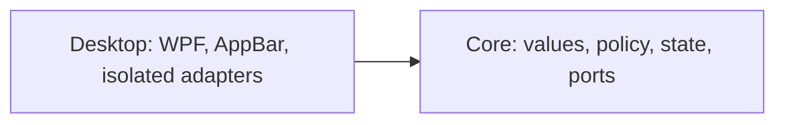

# MVP implementation plan

The [product plan](plan.md) defines scope and release order. [ADR 0002](adr/0002-appbar-first-cpu-ram-release.md) records the two-project architecture and AppBar feasibility gate; [ADR 0003](adr/0003-keep-appbar-registered-during-fullscreen.md) records fullscreen behaviour; [ADR 0004](adr/0004-subscription-limits-in-first-release.md) puts qualified subscription limits in the first release.

## Technology and layout

Use C# and .NET 10. `Core` targets plain `net10.0`; `Desktop` targets `net10.0-windows` x64 and uses WPF, System.Text.Json, and direct Win32 interop. Pin the SDK in `global.json`, enable nullable and warnings as errors, and commit package lock files generated for `win-x64`.

Blocking or potentially slow metric-source, file, and process operations run off the UI thread. HWND/AppBar operations, SetWindowPos, HwndSource message handling, tray icon actions, and monitor/DPI work tied to the window run on its owning WPF thread. Keep those handlers short; marshal collector results to the WPF dispatcher before updating UI-bound state.

```text
SystemResourceMonitor.slnx
src/
  SystemResourceMonitor.Core/
    Metrics/
    Monitoring/
    Settings/
  SystemResourceMonitor.Desktop/
    AppBar/
    Adapters/Windows/
    Adapters/Settings/
    ViewModels/
    Views/
    Tray/
    app.manifest
    App.xaml.cs
tests/
  SystemResourceMonitor.Core.Tests/
  SystemResourceMonitor.Desktop.Tests/
  SystemResourceMonitor.Desktop.TestHost/
```



Core has no Desktop dependency. Desktop adapters implement Core ports; view models do not reference concrete adapters. Wire implementations in `App.xaml.cs`. Do not introduce speculative repositories, mediators, generic result wrappers, or provider/thermal interfaces before their feature is accepted.

Enforce the Core boundary at build time. Core targets `net10.0`, does not set `UseWPF` or `UseWindowsForms`, and cannot reference Desktop. Add `Microsoft.CodeAnalysis.BannedApiAnalyzers` to Core only, include a Core `BannedSymbols.txt` as an `AdditionalFiles` item, and treat `RS0030` as an error. Ban `System.IO.File`, `System.IO.Directory`, `System.Diagnostics.Process`, `Microsoft.Win32.Registry`, `DllImportAttribute`, and `LibraryImportAttribute` by documentation-comment symbol IDs. An architecture test checks project references and the banned-symbol configuration. At slice 0, verify the check with temporary negative probes for each banned family: each must fail Core compilation with `RS0030`; remove the probes before committing. Review new I/O or interop entry points when dependencies change, since the list is a boundary check rather than a proof against every platform API.

`App.xaml.cs` owns the process-lifetime cancellation source, collector tasks, and deterministic shutdown sequence. Do not add Generic Host to the first release; reconsider it only when a concrete hosted-service requirement appears.

## Initial model and workflows

- `MetricReading` is an explicit union:
  - `AvailableMetric` contains kind, finite percentage in `0..100`, UTC `MeasuredAt`, a monotonic timestamp from `TimeProvider.GetTimestamp()`, and optional RAM used/total bytes;
  - `UnavailableMetric` contains kind and one reason: `NotYetSampled`, `Expired`, `Invalid`, or `ReadFailed`.
- `DashboardState` is immutable CPU/RAM and provider-limit state with one change notification. Marshal notifications once at the Desktop boundary.
- Source ports read CPU and RAM independently. One failure cannot stop the other source's acquisition or expiry.
- Inject `TimeProvider`; use UTC only for display and evidence, and monotonic timestamps for age and deadlines. Do not wrap it in `IClock`.
- Each collector polls every 2 seconds without overlapping its own reads. CPU uses `GetSystemTimes` deltas; the first sample is `NotYetSampled`. Counter reset or an invalid delta discards the baseline and produces `Invalid`. RAM uses `GlobalMemoryStatusEx`: `(total - available) / total`. These two synchronous native calls are accepted as short, in-process first-release reads, not as cancellable calls; run them on background thread-pool workers and measure their duration on the target PC. Neither reader owns a long-lived native handle.
- A separate timer marks each reading `Expired` at age `>= 6 seconds`, even while its collector is running. Failed reads do not renew either timestamp. Tooltips map the unavailability reason to a safe explanation.
- Cancellation stops scheduling new polls and prevents late results from publishing; it does not interrupt an in-flight GetSystemTimes or GlobalMemoryStatusEx call. Never start a second read for that source while one is pending. If an accepted first-release native call exceeds the 2-second poll interval, record the overrun and retain the no-overlap and 6-second freshness rules. Two consecutive overruns from either reader fail the first-release responsiveness gate. `Task.Run` keeps these short reads off the UI thread but does not make them cancellable.
- A provider or future thermal source that can genuinely block must run in a separate child process with a request timeout. On timeout or shutdown, terminate the child process tree, wait for exit within the remaining shutdown deadline, and release its owned resources only after exit. If termination cannot be confirmed, fail that source's acceptance and do not enable it. Do not run potentially blocking, non-terminable adapters in-process.
- Startup acquires the single-instance guard first. A second process exits before reading or writing settings and never registers another AppBar. The owner then loads settings, creates and registers the bar, and starts collectors.

## Settings and lifecycle

First-release settings contain only Top/Bottom edge, default Top. Store them at `%LocalAppData%\SystemResourceMonitor\settings.json`. Write a temporary file in the same directory and replace atomically. Missing settings use defaults. Preserve malformed settings as `settings.invalid-<timestamp>.json` when possible; inability to read, back up, or write settings does not prevent monitoring. On persistence failure, report that the current position applies only until restart.

On exit or handled fatal startup failure:

1. stop publishing state and cancel future polls;
2. remove the AppBar immediately in an idempotent `finally` path on the window thread;
3. wait at most 2 seconds total for collector tasks;
4. if the deadline expires, record which operation remains pending, reject any late result, and do not dispose resources still in use;
5. exit the process without awaiting that operation again.

Observe completion/fault of any pending managed task while the process remains alive; process termination ends its background workers. The first-release CPU/RAM readers own no long-lived native handles, so an in-flight read cannot race their disposal. Child-process adapters, including provider adapters, must be terminated and their exit confirmed inside the deadline; a failure to do so fails feature acceptance. Demonstrate the deadline path with a never-completing, handle-free fake source in the separate test host. Abrupt OS/process termination is distinct from handled cancellation and is not claimed as covered by `finally`.

## AppBar and shell behaviour

- Declare `PerMonitorV2` DPI awareness in `app.manifest`.
- Create one borderless, non-activating window on the primary monitor. Never steal focus.
- Register `ABM_NEW` with a `RegisterWindowMessage` callback, negotiate with `ABM_QUERYPOS`, and commit with `ABM_SETPOS`.
- Treat AppBar rectangles as physical pixels. Derive thickness from the current monitor DPI and apply the negotiated rectangle with `SetWindowPos(..., SWP_NOACTIVATE)`, not WPF DIP position properties.
- Handle `ABN_POSCHANGED`, `ABN_STATECHANGE`, `ABN_FULLSCREENAPP`, `WM_DISPLAYCHANGE`, and `WM_DPICHANGED` on the window thread. On a DPI change, renegotiate AppBar placement rather than accepting a stale WPF rectangle.
- On monitor, DPI, or primary-monitor changes, renegotiate with `ABM_QUERYPOS`/`ABM_SETPOS` against current monitor geometry, move to the current primary monitor, verify that the previous work area is restored, and reconcile fullscreen state.
- Fullscreen follows [ADR 0003](adr/0003-keep-appbar-registered-during-fullscreen.md): keep AppBar registration and its reserved strip throughout fullscreen; lower the window to the bottom of the z-order, then restore its normal z-order without activation when fullscreen is no longer active on the primary monitor. Never use `ABM_REMOVE` for a fullscreen transition.
- Treat `ABN_FULLSCREENAPP` as a trigger to reconcile current foreground-window bounds and monitor, not as an authoritative global fullscreen flag. Reconcile additionally every 500 ms so Alt+Tab restoration does not depend on game termination or another shell notification. Compare the foreground top-level window against the full primary-monitor bounds in physical pixels, not the reduced work area; exclude the bar and shell desktop windows. Coalesce checks and change z-order only when state changes. This reconciliation remains active while the bar is lowered and is included in the resource-budget measurements. Test maximized ordinary windows as a negative case.
- On `TaskbarCreated`, restore both shell integrations on the owning WPF thread: call `ABM_NEW`, then `ABM_QUERYPOS` and `ABM_SETPOS` to reserve the strip; call `Shell_NotifyIcon(NIM_ADD)` to recreate the tray icon, followed by `Shell_NotifyIcon(NIM_SETVERSION)`. Check native return values and report a failed recovery rather than assuming either resource exists. Reconcile fullscreen state before restoring z-order.
- Native wrappers check return codes, structure sizes, pointer widths, callback lifetimes, and handle ownership; use `SafeHandle` where ownership applies.
- The first-release tray contains position and exit actions only.

## Delivery slices

### Slice 0: runnable skeleton and empty AppBar

Create `SystemResourceMonitor.slnx` at the repo root and add Core, Desktop, both test projects, and the dedicated Windows test-host project. Create Core/Desktop, tests, the Core banned-API check, single-instance guard, blank AppBar, tray, edge persistence, and shutdown. Do not gate this work on provider or temperature research.

Pass build/tests and verify second launch leaves one process/window and exit leaves no background process. Use the separate test host to inject a handled startup failure and verify work-area restoration. Run every placement scenario in product-plan stage 1 on the published app. After an Explorer restart, verify the tray icon is present and its position and Exit actions still work. Perform ten top/bottom switches and verify no stale reservations. Record focus behaviour and work area before/during/after each scenario.

Time-box placement investigation to two working days. Remaining blocking failures stop dependent work pending an explicit placement/suspension decision and, if needed, ADR 0001 revision.

### Slice 1: CPU/RAM

Implement independent collectors and expiry, fixed-width CPU/RAM text, RAM GiB tooltip, and unavailable tooltips. A slow collector never overlaps itself, blocks the other collector, or delays UI exit. Measure native-read duration in the test host on the target PC for 30 minutes of normal polling; two consecutive GetSystemTimes or GlobalMemoryStatusEx calls longer than the 2-second poll interval fail the responsiveness gate. No empty placeholders for deferred features are required.

### Slice 2: subscription limits

Start after the slice 0 placement gate passes; run in parallel with slice 1. Qualify Codex and Claude sources independently against product-plan stage 3. Implement each accepted provider with the [provider adapter](#provider-adapters) requirements: fixed-width `short%/weekly%` section, all-windows tooltip, one-minute polling, independent three-minute expiry. A rejected provider gets no section and no placeholder. A provider failure never delays CPU/RAM acquisition, expiry, or the other provider.

### Slice 3: first personal release

Start when slice 1 is complete, both provider qualifications are closed, and every accepted provider is implemented. Publish a self-contained folder; document extraction, launch, position, exit, settings errors, unavailable readings, and provider sections. No install scripts or autostart yet.

Run accuracy, resource, artifact, provider, and real-desktop gates on the exact published production artifact with every accepted provider enabled. Run blocked-collector, exact-expiry, provider-freshness, and handled-startup-failure gates on a separate test-host build from the same commit with fault-injecting adapters. Record both artifact SHA-256 values and never distribute the test host.

### Independent later slices

These slices may proceed in any order after the first release and do not retroactively block it.

- **GPU:** implement adapter selection/correlation and reused PDH queries; use the product-plan GPU acceptance, with unavailable rather than guessed correlation.
- **Installation/autostart:** implement the product-plan installation and autostart controls independently of GPU. Preserve settings during upgrade and make uninstall's settings-retention choice explicit.
- **Temperatures:** research source/license/driver/Defender behaviour last; never elevate the bar. No acceptable source means no temperatures.

Later feature acceptance reruns affected first-release gates, including resource budgets with the enabled feature configuration.

## Provider and installation requirements

### Provider adapters

- Resolve an official client from authoritative installation metadata or explicit user selection, never the current directory or the first untrusted `PATH` hit.
- Canonicalize the final executable path, reject reparse redirection and locations writable by other principals, and verify its publisher signature where the official client supplies one. An unverifiable user-installed script client requires explicit user consent.
- Start the verified executable directly with `UseShellExecute=false`, fixed argument tokens, a neutral working directory, no shell window, and a bounded timeout.
- Drain stdout and stderr concurrently with independent byte limits. Bound parser depth and record/token counts; on any limit, timeout, or cancellation, terminate the process tree and mark the provider unavailable.
- Keep parsing separate from process execution and use sanitized fixtures. Never retain or log raw account output, credentials, tokens, cookies, or browser data.
- Poll providers independently. Sign-out becomes unavailable on the first failed poll. A network failure retains explicitly stale data only until three minutes from the last success; expiry uses its own timer and does not wait for another poll.
- Reject unknown formats and versions. Convert used to remaining percentage with the official client's verified rounding and select the binding weekly window by the glossary rule.
- Acceptance compares every displayed remaining value and reset time with the official client in the same verification window, confirms the failure explanation in the tooltip after access loss, and repeats the ten-poll non-consumption check. Manual account comparison is separate from parser tests.

### Installation and autostart

- Install under a fixed canonical per-user directory with ACLs that do not grant write access to other principals. Recheck ACLs and reject reparse points during install, upgrade, registration, and uninstall.
- Write one owned `HKCU\Software\Microsoft\Windows\CurrentVersion\Run` `REG_SZ` value containing a correctly quoted absolute executable path, no shell interpolation, and no user-controlled arguments.
- Uninstall removes only that exact Run value and manifest-listed application files. Cover paths with spaces, planted prefix executables, changed ACLs, and junction/symlink replacement.

## First-release acceptance gates

All thresholds below are release-blocking, not record-only. They are agreed initial budgets for the target PC, not measured results. Use two artifacts from one commit: the clean, self-contained published app for normal operation, accuracy, resource, and desktop gates; a separate Release executable from `SystemResourceMonitor.Desktop.TestHost` for injected blocked-source and startup-failure gates. The test host instantiates the same production lifecycle components with fake sources at their composition seam; its injection code and fixtures live only in the test-host project and are excluded from the published folder. It must exercise a real HWND/AppBar on Windows 11 for work-area assertions. Record the commit and SHA-256 of both executable artifacts and their loaded production assemblies in the sanitized acceptance report described below. Evidence from one artifact does not establish behavior of the other. Untested scenarios remain open.

| Gate | Artifact | Method and pass condition |
|---|---|---|
| CPU accuracy | Published app | Idle and sustained CPU load separately: 30 paired observations at 2-second intervals, compared with Task Manager using the same 60-second observation window. Difference between window means `<= 5` percentage points in each regime. Record transition spikes separately. |
| RAM accuracy | Published app | Idle and sustained load separately: 30 paired observations per regime against Task Manager physical memory usage. Absolute difference `<= 2` percentage points in at least 29/30 observations in each regime. Record used/total values. |
| App CPU cost | Published app | Release build, 30 minutes at idle; process CPU time delta / elapsed wall time / logical processor count × 100 `<= 0.5%`. Report this whole-machine-normalized definition explicitly. |
| App memory ceiling | Published app | Sample process private bytes every 2 seconds during the 30-minute idle run and eight-hour run; every sample `<= 150 MiB`. |
| Memory growth | Published app | Warm up 30 minutes, then observe for 8 hours with 2-second private-byte samples. Last 30-minute mean minus first 30-minute mean `<= 10 MiB`. This does not prove absence of all leaks. |
| Native-read responsiveness | Test host | Use the production CPU/RAM wrappers for 30 minutes on the target PC; timestamp every call. Neither reader has two consecutive calls longer than 2 seconds. The published app also remains responsive throughout its desktop and resource runs. |
| Freshness and independence | Test host | Block one collector; its reading expires at 6 seconds while the other keeps updating. Test the exact boundary with fake time; observe actual UI transition within 0.5 seconds of the deadline. |
| Provider freshness and independence | Test host | For each accepted provider with fake time: sign-in failure is unavailable on the first failed poll; after a network failure, stale data shows `--/--` at three minutes since the last success without another poll; a blocked or timed-out provider never delays CPU/RAM or the other provider, and its child process tree is terminated within the shutdown deadline. |
| Provider limits | Published app | For each accepted provider, the product-plan stage 3 manual account check passes: displayed remaining values and reset times match the official client in the same window, access loss shows `--/--` with a safe explanation, and the ten-poll non-consumption check passes with the built adapter. |
| Normal shutdown | Published app | Normal exit restores prior work area before collector wait; process exits without leftovers. |
| Fault shutdown | Test host | Inject a handled startup failure and a never-completing, handle-free source. Both restore prior work area before collector wait. At the 2-second total deadline, pending work is recorded, late results cannot publish, no in-use resource is disposed, and the process exits without leftovers. |
| Desktop behaviour | Published app | All product-plan stage 1 scenarios pass on actual Windows 11. Ten enter/leave cycles each for video, exclusive fullscreen, and borderless fullscreen, including Alt+Tab to a normal window and back: lower only for active fullscreen on the primary monitor; restore within 1 second after departure, without focus stealing. Keep registration and reservation unchanged through transitions. Separately verify Explorer restart during fullscreen, fullscreen on a second monitor, and ordinary maximized windows. After Explorer recovery the strip is reserved, correct z-order returns, and the restored tray icon's position and Exit actions work. Primary-monitor changes move and reserve the bar on the new primary while restoring the old work area; no stale reservations remain. |
| DPI and rendering | Published app | At 100%, 150%, and 200% scaling, the reserved strip matches the rendered bar; CPU/RAM and provider sections remain fixed, unclipped, and stable for 0%, 100%, and unavailable; the RAM tooltip shows used/total GiB. |
| Artifact hygiene | Published app | Folder runs without separately installed .NET, no elevation, and no provider authorization (provider sections then show unavailable), and contains no test host, fixtures, secrets, development configuration, or production diagnostic hook. |

For the eight-hour run, keep normal monitoring active and record workload changes and interruptions. Missing samples or interrupted runs cannot count as a passing complete run.

Commit only a sanitized acceptance report under `docs/acceptance/`: target hardware category, Windows build, logical processor count, display/DPI/taskbar configuration, commit, artifact hashes, instrumentation, aggregate observations, and pass/fail. Keep raw traces privately only as long as needed to diagnose the run. Never commit usernames, absolute user paths, account/provider output, process or window titles, environment dumps, precise activity timelines, or unredacted screenshots.

## Automated verification and handoff

Permanent tests cover metric invariants and unavailable reasons, CPU delta arithmetic and reset, independent failures, no overlap, monotonic six-second expiry during a blocked read, exact deadline, bounded shutdown, guard-before-settings startup, and settings recovery/write failure. Desktop lifecycle tests cover registered-to-lowered-to-restored transitions without ABM_REMOVE, Alt+Tab while the game stays running, other-monitor fullscreen, repeated notifications, maximized-window exclusion, and Explorer recovery that recreates both AppBar and tray icon before reconciliation. The Core `net10.0` target, project-reference rule, and `RS0030` banned-API build check enforce its boundary; slice-0 negative probes verify the check itself. Test actual settings files with temporary directories; avoid mock echoes, DI registration tests, and XAML/property-forwarding tests.

Windows integration exercises native wrappers, mutex, AppBar, DPI conversion, fullscreen recovery, and Explorer restart where practical. Actual published-app checks remain mandatory; CI success alone cannot close desktop or resource gates.

Once application projects exist, run on Windows 11:

```powershell
dotnet restore SystemResourceMonitor.slnx -r win-x64 --locked-mode
dotnet build SystemResourceMonitor.slnx -c Release -r win-x64 --no-restore
dotnet test SystemResourceMonitor.slnx -c Release -r win-x64 --no-build --no-restore
dotnet publish src/SystemResourceMonitor.Desktop/SystemResourceMonitor.Desktop.csproj -c Release -r win-x64 --self-contained true -p:RestoreLockedMode=true
git diff --check
```

Copy the published folder to the target PC for its named gates. Run injected-fault gates with the separate test host on the same target PC; record both artifact hashes and the common commit. Build/test/publish commands are future implementation checks; this documentation change does not establish that any have passed.

## Public distribution gate

The first personal release may remain unsigned. Do not distribute a build publicly until the public-release checks in the product plan pass and a signed provenance manifest authenticates the exact payload files being distributed. Generate the manifest after final packaging; include source commit and SHA-256 for every payload file, including executables, DLLs, and scripts. Sign it with a release key whose verification key or fingerprint users obtain from an independently authenticated channel, separate from the artifact download. On the final distribution package, verify the manifest signature against that trusted key and recompute every listed hash; reject missing, extra, or mismatched payload files. Record the trusted-key identity, signature-verification result, package/manifest hashes, and release commit. A plain SHA-256 file beside the download is only an integrity check and cannot close this gate.

## Out of scope

Multiple bars/non-primary placement, graphs/history/alerts, customizable refresh/fonts/size, browser automation/cookies, undocumented provider endpoints, credential storage, billing balances, interactive sign-in, automatic updates, MSIX/MSI, Authenticode signing for the personal release, localization, telemetry, privileged helpers, and platforms other than Windows 11 x64. Authenticated provenance is required before public distribution as specified above.
